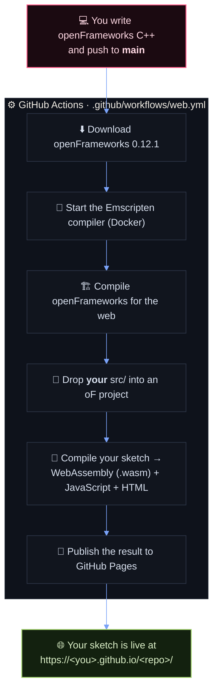
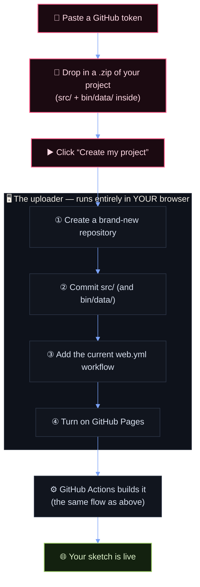
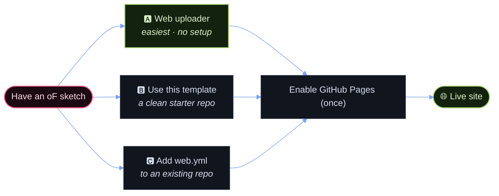

<div align="center">

# openFrameworks&nbsp;→&nbsp;Web

### Write C++. Push to GitHub. Watch it run in a browser — at a public URL, with no local toolchain.

<br/>


**[▶ Live demo](https://maxfishman.github.io/OpenFrameworksTest/)** · **[⚡ Uploader](https://maxfishman.github.io/OpenFrameworksTest/uploader/)** · **[🖼️ Gallery](https://maxfishman.github.io/OpenFrameworksTest/gallery/)** · **[📖 Docs](https://maxfishman.github.io/OpenFrameworksTest/docs/)**

</div>

> [!TIP]
> **New here?** The fastest route is the [**web uploader**](#-publish-in-one-click-the-web-uploader):
> drop in your `src/`, and it creates the repo, adds the workflow, and turns on Pages for you —
> no template, no command line.

---

## Table of contents

1. [How it works (the big picture)](#-how-it-works-the-big-picture)
2. [Publish in one click (the web uploader)](#-publish-in-one-click-the-web-uploader)
3. [What's in this repo](#-whats-in-this-repo)
4. [Quick start: convert your own project](#-quick-start-convert-your-own-project)
5. [Enabling GitHub Pages (one-time)](#-enabling-github-pages-one-time)
6. [Controls in the demo](#-controls-in-the-demo)
7. [Writing code that works on the web](#-writing-code-that-works-on-the-web)
8. [What the workflow does, step by step](#-what-the-workflow-does-step-by-step)
9. [Troubleshooting](#-troubleshooting)
10. [Advanced: addons, pinning versions, caching](#-advanced-addons-pinning-versions-caching)
11. [FAQ](#-faq)

---

## 🧭 How it works (the big picture)

Normally, building an openFrameworks app for the web means installing Emscripten,
downloading openFrameworks, compiling the whole framework, and then compiling your
sketch — all on your own machine. That's a lot of setup.

Instead, this repo hands all of that to a **GitHub Actions workflow** — a script that
GitHub runs for you on its own servers:



The only files **you** maintain are your source code in `src/` (and optional assets in
`bin/data/`). The workflow supplies everything else.

---

## ⚡ Publish in one click (the web uploader)

Setting up the template by hand is fine, but there's an even shorter path: the
**web uploader**, a small browser app that does the GitHub wiring for you.

**Open it → https://maxfishman.github.io/OpenFrameworksTest/uploader/**



- **No server, no setup.** The uploader is a static page. The GitHub token you paste
  stays only in your browser tab and is sent directly to GitHub — never to us.
- **It bundles the latest workflow.** Each deploy stamps the current `web.yml` into the
  uploader, so repos it creates always get the up-to-date build (cache fixes included).
- **It's a PWA.** You can install it and it works offline for everything except the
  actual GitHub calls.
- The demo page also has a **“Publish your sketch”** button that opens the uploader.

See [`web/uploader/`](web/uploader/) for the source, and the
[Privacy Policy](web/uploader/privacy.html) / [Terms of Service](web/uploader/terms.html).

---

## 📁 What's in this repo

```
.
├── .github/
│   └── workflows/
│       └── web.yml            ← the build-and-deploy workflow (the important part)
├── src/
│   ├── main.cpp               ← creates the window and starts the app
│   ├── ofApp.h / ofApp.cpp    ← your sketch (setup / draw / input)
│   └── mover.hpp / mover.cpp  ← a helper class used by the demo
├── web/                       ← extras layered onto the published page (not the sketch)
│   ├── sw.js                  ← combined COOP/COEP + offline service worker (demo)
│   ├── icons/                 ← PWA / favicon icons
│   ├── og/                    ← social-preview (Open Graph) image
│   ├── uploader/              ← the one-click publish app (index, privacy, terms, QR)
│   ├── gallery/               ← showcase of published sketches (auto-discovers a topic)
│   └── docs/                  ← standalone themed docs page
└── README.md                  ← you are here
```

The `src/` folder is the only part you'd normally edit. There is **no** `bin/`, no
openFrameworks copy, and no Makefile in the repo — the workflow adds those during the
build so you never commit them. The `web/` folder is optional chrome the workflow copies
onto the deployed site; your own sketch doesn't need it.

---

## 🚀 Quick start: convert your own project

There are a few easy ways to get your sketch building on the web.



### Option A — Use the web uploader (easiest, no setup)

Open the [**web uploader**](https://maxfishman.github.io/OpenFrameworksTest/uploader/),
paste a GitHub token, drop in a `.zip` of your project (with `src/` and `bin/data/`
inside), and click **Create my project**. It makes the repo, adds the workflow, and turns on Pages
for you. See [Publish in one click](#-publish-in-one-click-the-web-uploader) above.

### Option B — Use this repo as a template

1. On this repo's GitHub page, click **“Use this template” → “Create a new repository.”**
   (If that button isn't available, just fork it, or use Option C.)
2. Clone your new repo, delete the demo code in `src/`, and drop in **your own**
   `src/` files (`main.cpp`, `ofApp.h`, `ofApp.cpp`, plus any other classes).
3. If your sketch loads images, fonts, sounds, etc., put them in `bin/data/`
   (create the folder if it doesn't exist).
4. Commit and push to the `main` branch.
5. Do the [one-time Pages setup](#-enabling-github-pages-one-time).
6. Wait for the build (watch the **Actions** tab). When it's green, open your site.

### Option C — Add the workflow to an existing repo

1. Copy the single file `.github/workflows/web.yml` from this repo into the **same
   path** in your repo.
2. Make sure your C++ lives in a top-level `src/` folder and assets (if any) in
   `bin/data/`.
3. Commit, push to `main`, then do the [Pages setup](#-enabling-github-pages-one-time).

> [!IMPORTANT]
> Your project must follow the standard openFrameworks layout — `src/` for code,
> `bin/data/` for assets. The workflow looks for exactly those folders. Don't commit your
> own `bin/`, `obj/`, Makefiles, or an openFrameworks copy.

---

## 🔧 Enabling GitHub Pages (one-time)

The workflow builds your page on every push, but GitHub won't _publish_ it until you
turn Pages on and point it at GitHub Actions. Do this once per repo:

1. Go to your repo → **Settings** → **Pages**.
2. Under **“Build and deployment” → “Source,”** choose **“GitHub Actions.”**
3. That's it. Push again (or re-run the workflow) and it will deploy.

Your site will be at:

```
https://<your-github-username>.github.io/<your-repo-name>/
```

> [!NOTE]
> The **first** time you visit, the page may reload itself once. That's normal — see
> [“Why does the page reload once?”](#-faq).

---

## 🎮 Controls in the demo

| Key / action            | What it does                                  |
| ----------------------- | --------------------------------------------- |
| **`f`**                 | Toggle fullscreen                             |
| **“Fullscreen” button** | Same as `f` (built into the page)             |
| **`r`**                 | Restart the sketch (re-randomizes the movers) |

Fullscreen in the browser has to be triggered by a real user action (a key press or
click) and routed through Emscripten — you can't force it from code at startup.
See `ofApp::toggleFullscreen()` in `src/ofApp.cpp` for how the `f` key does it.

---

## 🧠 Writing code that works on the web

Most openFrameworks code “just works,” but the web is not a desktop. Keep these in
mind:

- **Target openFrameworks 0.12.1.** That's the version the workflow downloads. Code
  that relies on newer or older APIs may not compile. (You can change the version —
  see [Advanced](#-advanced-addons-pinning-versions-caching).)
- **Window setup.** `src/main.cpp` uses `ofGLWindowSettings` and starts in
  `OF_WINDOW` mode. That's correct for the web. Desktop-only window features
  (multi-monitor, native fullscreen at launch) don't translate directly.
- **Fullscreen.** Use a key/click to toggle it. This repo wires `f` and the page's
  **Fullscreen** button; both scale the canvas to fill the screen.
- **File loading is relative to `bin/data/`.** Put assets there and load them with
  plain relative paths, e.g. `img.load("photo.png")`.
- **No blocking / no threads-by-default.** Don't write infinite loops or block the
  main thread — the browser needs to breathe each frame. (openFrameworks' threaded
  features need special headers; this workflow already adds them, see below.)
- **Resizing.** The browser canvas can change size. The demo handles
  `windowResized()` by re-allocating its FBO — a good pattern to copy.

---

## 📜 What the workflow does, step by step

This is `.github/workflows/web.yml` in plain English. You don't need to understand
every line to use it, but it helps when debugging.

1. **Trigger.** Runs on every push to `main`, and can be run manually from the
   **Actions** tab (“Run workflow”).
2. **Get your sketch.** Checks out your repo into a folder called `sketch/`.
3. **Get openFrameworks 0.12.1.** Clones the framework into `of/`.
4. **Download the web libraries.** openFrameworks ships prebuilt web dependencies;
   this fetches them.
5. **Start Emscripten.** Launches the `emscripten/emsdk:4.0.4` compiler inside Docker.
6. **Build openFrameworks for the web.** Compiles the whole framework once (this is
   the slowest step).
7. **Set up your project.** Copies your `src/` and `bin/data/` into an openFrameworks
   app folder, and adds the standard web `Makefile`/`config.make`. It also:
   - drops a tiny placeholder file into `bin/data/` (the packager errors on a
     completely empty data folder);
   - adds a small `reallocarray` compatibility shim (this Emscripten version omits a
     function the prebuilt libraries expect).
8. **Build your sketch.** Compiles your code to `.wasm` + `.js` + `.html`.
9. **Make it work on GitHub Pages.** openFrameworks web builds use threads, which
   need special HTTP headers (`SharedArrayBuffer`). GitHub Pages can't send those, so
   the workflow adds [`coi-serviceworker`](https://github.com/gzuidhof/coi-serviceworker)
   to supply them in the browser. It also injects a small CSS rule so fullscreen
   actually fills the screen.
10. **Package & deploy.** Uploads the finished page and publishes it to GitHub Pages.

The final page lives (inside the build) at
`of/apps/myApps/sketch/bin/em/sketch/` — useful to know if you read the build logs.

---

## 🩺 Troubleshooting

Open the **Actions** tab, click the failing run, and read the logs — the error is
almost always in the **“Build the sketch for the web”** step.

| Symptom                                            | Likely cause & fix                                                                                                                       |
| -------------------------------------------------- | ---------------------------------------------------------------------------------------------------------------------------------------- |
| **Build fails with C++ compile errors**            | A bug in _your_ `src/` code, or an API that doesn't exist in oF 0.12.1. Fix the code the compiler points at.                             |
| **Build fails, but compiles fine on your desktop** | You're probably on a different openFrameworks version locally. Match 0.12.1, or pin the workflow to your version (see Advanced).         |
| **Page is blank / stuck on “Downloading…”**        | Open the browser's **developer console** (F12) for the real error. Often a missing asset path or a crash in `setup()`.                   |
| **Assets (images/fonts/sounds) don't load**        | They must be in `bin/data/` and loaded with relative paths. Confirm the file is committed and the name/case matches exactly.             |
| **Fullscreen does nothing**                        | It must be triggered by a key/click (try `f` or the button), not called automatically. If you customized this, see `toggleFullscreen()`. |
| **Deploy step fails**                              | GitHub Pages isn't enabled, or isn't set to “GitHub Actions.” Do the [one-time setup](#-enabling-github-pages-one-time).                  |
| **Page reloads itself once on first visit**        | Expected — `coi-serviceworker` installs, then reloads so the threading headers apply.                                                    |
| **Addons don't work**                              | Bundled + registry addons are auto-detected; others (or native/hardware ones like `ofxOpenCv`) may be unsupported on the web. See Advanced. |
| **First build takes ~10–15 minutes**               | Normal — the first run compiles all of openFrameworks. Later builds are cached (~1–2 min). See caching in Advanced.                      |

---

## 🧰 Advanced: addons, pinning versions, caching

You only need this section if you're pushing past the basics.

### Using addons

The workflow **auto-detects addons** your sketch `#include`s and wires them up for you —
you don't write an `addons.make`:

- **Bundled addons** (anything that ships with openFrameworks — `ofxGui`,
  `ofxXmlSettings`, `ofxSvg`, `ofxVectorGraphics`, …) are added automatically when the
  sketch references them.
- **Popular third-party addons** are cloned at build time from a small registry in
  `web.yml` (the **“Set up the sketch project”** step): `ofxBox2d`, `ofxFft`, `ofxDatGui`,
  `ofxAnimatable`, `ofxEasing`, `ofxPostProcessing`. To support another, add a
  `name|git-repo` line to that `REGISTRY` list.

**Not everything can run in a browser.** Sketches compile to WebAssembly, so addons that
need native libraries, hardware, or raw sockets won't work — notably **`ofxOpenCv`**
(OpenCV isn't built for WebAssembly), **`ofxKinect`** (hardware), and **`ofxNetwork` /
`ofxOsc`** (TCP/UDP sockets; browsers only allow WebSockets). The uploader's pre-flight
check flags these **before** you spend a build.

### Pinning / changing the openFrameworks version

The version is set in the **“Get openFrameworks …”** step:

```yaml
git clone --depth 1 --branch 0.12.1 https://github.com/openframeworks/openFrameworks.git of
```

Change `0.12.1` to another release tag to match the version you develop against. Keep
the Emscripten image (`emscripten/emsdk:4.0.4`) compatible with it.

### Build caching (already on)

The first build compiles all of openFrameworks (~10–15 min), but the workflow **caches the
compiled framework** with [`actions/cache`](https://github.com/actions/cache), so later
builds restore it and skip that step — dropping to ~1–2 minutes. Two details make the cache
actually work (both already handled in `web.yml`):

- **`touch` the restored objects** so `make` sees them as newer than the freshly-cloned
  sources and doesn't recompile.
- **`chown` the Docker build outputs** back to the runner so `actions/cache` can read *all*
  of them when it saves — otherwise the cache is incomplete and oF rebuilds anyway.

The cache key pins the oF and Emscripten versions, so bumping either starts a fresh cache.

---

## ❓ FAQ

<details>
<summary><b>Do I need to install anything on my computer?</b></summary>

No. You can edit files directly on GitHub if you want. For comfortable local
development, install openFrameworks 0.12.1 and use your normal IDE — but the _web_
build only ever happens on GitHub's servers.
</details>

<details>
<summary><b>Can I test locally before pushing?</b></summary>

You can run your sketch as a normal desktop openFrameworks app locally. The web build
is produced by the workflow; there's no separate local web step in this setup.
</details>

<details>
<summary><b>Why does the page reload once?</b></summary>

openFrameworks web builds use threads, which the browser only allows with special
security headers. GitHub Pages can't send them, so a tiny helper
(`coi-serviceworker`) installs itself and reloads the page so the headers take effect.
It only happens on the first load.
</details>

<details>
<summary><b>Is my sketch public?</b></summary>

If your repo is public and Pages is on, anyone with the URL can view it. For a private
repo, GitHub Pages deployment requires a paid GitHub plan.
</details>

<details>
<summary><b>Is the uploader's GitHub token safe to paste?</b></summary>

The token lives only in that browser tab (`sessionStorage`) and is sent straight to
GitHub's API — it never reaches any server of ours. Give it a short expiration and the
minimum scopes (`public_repo`, `workflow`, which the uploader pre-ticks), and you can
revoke it anytime at **GitHub → Settings → Developer settings → Tokens**. See the
uploader's [Privacy Policy](web/uploader/privacy.html).
</details>

<details>
<summary><b>Where do I change the window size?</b></summary>

In `src/main.cpp`: `settings.setSize(1024, 768);`. On the web the canvas is then
scaled to fit the page / fullscreen.
</details>

<details>
<summary><b>How long until my changes are live?</b></summary>

The first build is roughly 10–15 minutes; after that the compiled framework is cached, so
later builds take ~1–2 minutes, plus a short propagation delay after deploy. Watch the
**Actions** tab for progress.
</details>

---

<div align="center">

**Happy sketching — push some C++ and watch it run in a browser.** 🎨

<sub>Built by <b>Max Fishman</b> + <b>Luisa Pinzon</b> · Executive Directors — Digital Arts</sub>

</div>
